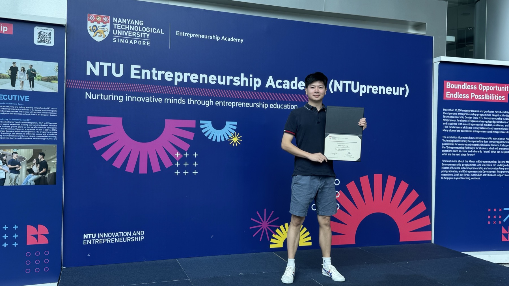

# SymFace: AR & Wellness AI

<p align="center">
  
  
</p>

<p align="center"><strong>A curated public subset of a team-built iOS/watchOS wellness prototype.</strong></p>

SymFace explores how on-device sensing, structured context assembly, multiple AI providers, and validated plan generation can be combined into a personal wellness workflow. The full prototype integrates SwiftUI, ARKit/SceneKit, HealthKit, Apple Watch connectivity, local persistence, and selected third-party AI services.

This repository is intentionally limited to safe, reviewable components that demonstrate the engineering patterns behind the project. It is not the complete mobile application and is not a clinically validated product.

## What This Repository Shows

- Deterministic provider routing for care-plan, conversational, and offline-fallback requests.
- Bounded context assembly from a scan summary and selected wellness signals.
- Codable care-plan models with local exercise-library validation before persistence.
- Unit tests for routing, context safety boundaries, and structured-output validation.

The implementation is provider-agnostic: it does not make network requests, store API keys, or include vendor SDK credentials.

## System Context

```text
AR / wellness observations ─┐
                            ├─> bounded context ─> provider routing ─> structured plan
selected health signals ───┘                              │
                                                         └─> local validation
                                                              against exercise library
```

The full team prototype also includes iPhone/watchOS UI, AR-based measurement, local history, HealthKit context, WatchConnectivity synchronization, and integrations with external AI and analysis services. Those application and vendor-integration layers are intentionally omitted from this public subset.

## Repository Layout

```text
PublicSubset/
├── Sources/SymFacePublic/
│   ├── AgentRouting.swift
│   ├── WellnessContext.swift
│   └── CarePlan.swift
└── Tests/SymFacePublicTests/
    └── SymFacePublicTests.swift
```

## Run The Tests

Requires Swift 6 or later:

```bash
swift test --package-path PublicSubset
```

The package uses Foundation and the Swift Testing framework. No API key, external service, dataset, or private configuration is required.

## Scope And Attribution

SymFace was developed as a team project. This repository is a portfolio-oriented release of selected patterns and reference implementations, not a claim that the public files represent the entire production or academic project. Proprietary application code, private data, credentials, signing assets, third-party SDK configuration, and team-internal materials are excluded.

The images in this README document the NTU entrepreneurship and project-recognition context. They are included for portfolio context and are not software assets used by the package.

## Disclaimer

SymFace is a wellness and self-observation prototype. The public subset must not be used for medical diagnosis, treatment decisions, or clinical deployment.

